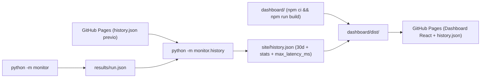
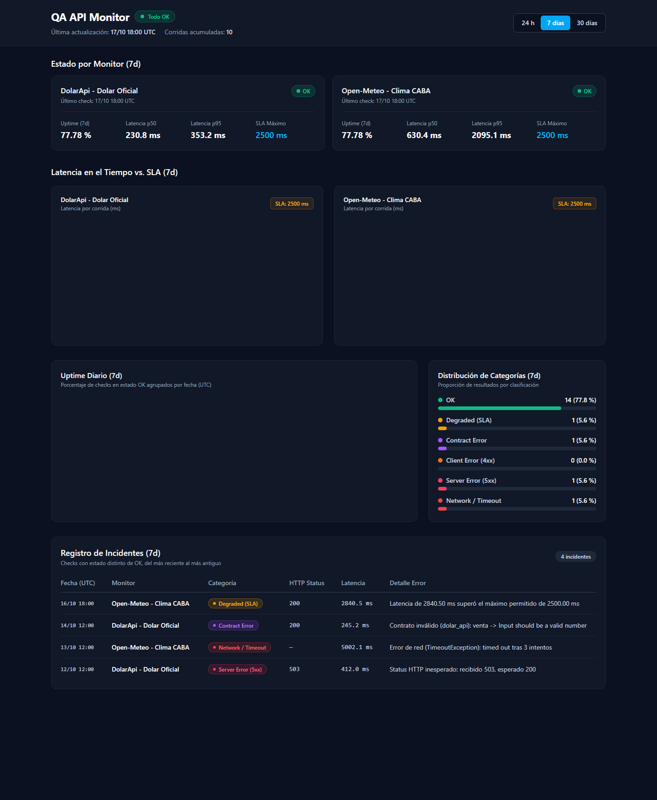

# qa-api-monitor

[](https://github.com/facupeletay/qa-api-monitor/actions/workflows/ci.yml)

Monitor de APIs en Python que lee endpoints desde un archivo YAML (`config/monitors.yaml`), ejecuta peticiones HTTP con reintentos y backoff exponencial, mide la latencia por intento y la duración total, valida esquemas/contratos JSON con Pydantic v2, clasifica las fallas por categoría y publica un reporte histórico en **GitHub Pages**.

🌐 **Sitio publicado (Estado e Historial):** [https://facupeletay.github.io/qa-api-monitor/](https://facupeletay.github.io/qa-api-monitor/)

---

## Cómo funciona

El flujo automatizado corre cada 6 horas en GitHub Actions sin ensuciar el historial de commits del repositorio:



1. **`python -m monitor`** consulta cada API configurada en `config/monitors.yaml`, valida status HTTP, contrato JSON y SLA de latencia, genera `results/run.json` y opcionalmente escribe una tabla resumen en Markdown (`--summary-md`).
2. **`python -m monitor.history`** descarga el `history.json` publicado actualmente en GitHub Pages con cache-busting y `Cache-Control: no-cache` (o arranca vacío si devuelve `404` en la primera corrida; si hay error `5xx`, timeout o JSON corrupto, aborta para proteger el historial), agrega la corrida nueva, descarta registros de más de 30 días y calcula métricas de las últimas **24 horas** y **7 días** (uptime %, p50, p95, SLA `max_latency_ms` y conteo por categoría).
3. **`dashboard/` (React + Vite + TypeScript + Tailwind + Recharts)** compila el sitio estático con `base: "/qa-api-monitor/"`, copia el `history.json` actualizado dentro de `dashboard/dist/history.json` y **GitHub Pages** publica ese directorio.



---

## Requisitos

- Python 3.12+
- Node.js 22+ y npm

## Instalación (Backend Python)

1. Crear y activar el entorno virtual:

```powershell
py -3.12 -m venv .venv
.\.venv\Scripts\Activate.ps1
```

2. Instalar el proyecto y sus dependencias de desarrollo:

```powershell
python -m pip install -e ".[dev]"
```

## Cómo correr el monitor y el historial localmente

Ejecutar los checks:

```powershell
python -m monitor
```

Opcionalmente con rutas personalizadas y resumen Markdown:

```powershell
python -m monitor --config config/monitors.yaml --output results/run.json --summary-md results/summary.md
```

### Códigos de salida de `python -m monitor`

| Código | Significado |
| :---: | :--- |
| `0` | Todos los checks finalizaron en categoría `ok`. |
| `1` | Al menos un check finalizó en estado distinto de `ok` (`degraded`, `contract_error`, `client_error`, `server_error`, `network_error`). |
| `2` | Error de configuración (`ConfigError`, archivo YAML inexistente o inválido) o error interno no esperado. |

Actualizar el historial (usando un archivo previo local o la URL de GitHub Pages):

```powershell
python -m monitor.history --previous https://facupeletay.github.io/qa-api-monitor/history.json --run results/run.json --output site/history.json
```

## Cómo correr el Dashboard localmente (`dashboard/`)

En modo desarrollo (`npm run dev`), Vite sirve automáticamente el fixture de ejemplo `dashboard/sample-history.json` (con múltiples días e incidentes de distintas categorías) sin incluirlo en el build de producción:

```powershell
cd dashboard
npm install
npm run dev
```

Abrir en el navegador: `http://localhost:5173/qa-api-monitor/`

Para ejecutar linter, tests unitarios (Vitest) y el build de producción del dashboard:

```powershell
cd dashboard
npm run lint
npm test
npm run build
```

## Cómo correr los tests y el linter (Python)

Ejecutar la suite de pruebas con cobertura (`pytest`, `respx` y `pytest-cov`):

```powershell
pytest --cov=monitor --cov-report=term-missing
```

Ejecutar `ruff` para lint y formato:

```powershell
ruff check .
ruff format --check .
```
