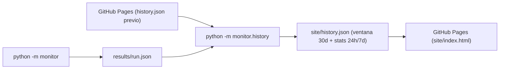

# qa-api-monitor

[](https://github.com/facupeletay/qa-api-monitor/actions/workflows/ci.yml)

Monitor de APIs en Python que lee endpoints desde un archivo YAML (`config/monitors.yaml`), ejecuta peticiones HTTP con reintentos y backoff exponencial, mide la latencia por intento y la duración total, valida esquemas/contratos JSON con Pydantic v2, clasifica las fallas por categoría y publica un reporte histórico en **GitHub Pages**.

🌐 **Sitio publicado (Estado e Historial):** [https://facupeletay.github.io/qa-api-monitor/](https://facupeletay.github.io/qa-api-monitor/)

---

## Cómo funciona

El flujo automatizado corre cada 6 horas en GitHub Actions sin ensuciar el historial de commits del repositorio:



1. **`python -m monitor`** consulta cada API configurada en `config/monitors.yaml`, valida status HTTP, contrato JSON y SLA de latencia, y genera `results/run.json`.
2. **`python -m monitor.history`** descarga el `history.json` publicado actualmente en GitHub Pages (o arranca vacío si devuelve `404` en la primera corrida; si hay error `5xx`, timeout o JSON corrupto, aborta para proteger el historial), agrega la corrida nueva, descarta registros de más de 30 días y calcula métricas de las últimas **24 horas** y **7 días** (uptime %, p50, p95 y conteo por categoría).
3. **GitHub Pages** despliega la carpeta `site/` con `index.html` y el nuevo `history.json`.

---

## Requisitos

- Python 3.12+

## Instalación

1. Crear y activar el entorno virtual:

```powershell
py -3.12 -m venv .venv
.\.venv\Scripts\Activate.ps1
```

2. Instalar el proyecto y sus dependencias de desarrollo:

```powershell
python -m pip install -e ".[dev]"
```

## Cómo correr el monitor y el historial localmente

Ejecutar los checks:

```powershell
python -m monitor
```

Actualizar el historial (usando un archivo previo local o la URL de GitHub Pages):

```powershell
python -m monitor.history --previous https://facupeletay.github.io/qa-api-monitor/history.json --run results/run.json --output site/history.json
```

## Cómo correr los tests y el linter

Ejecutar la suite de pruebas con cobertura (`pytest`, `respx` y `pytest-cov`):

```powershell
pytest --cov=monitor --cov-report=term-missing
```

Ejecutar `ruff` para lint y formato:

```powershell
ruff check .
ruff format --check .
```
